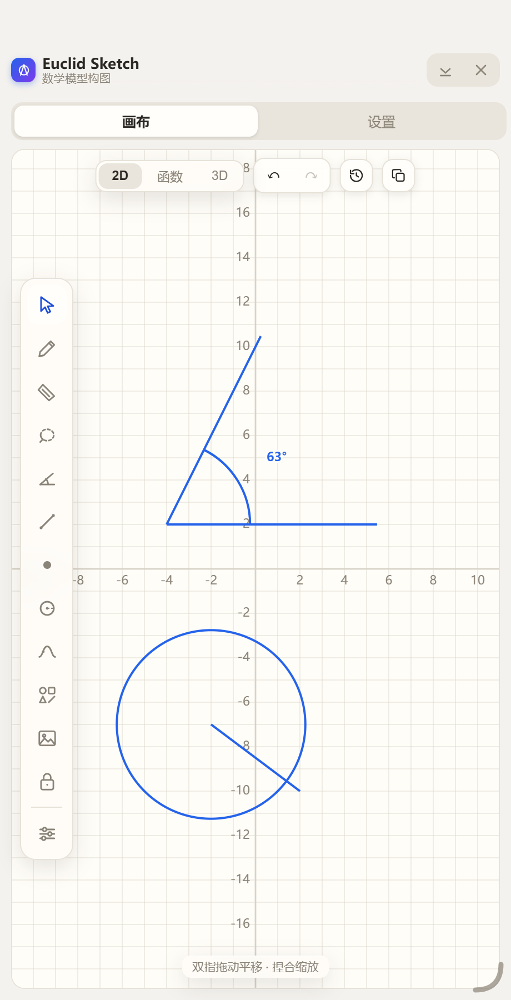
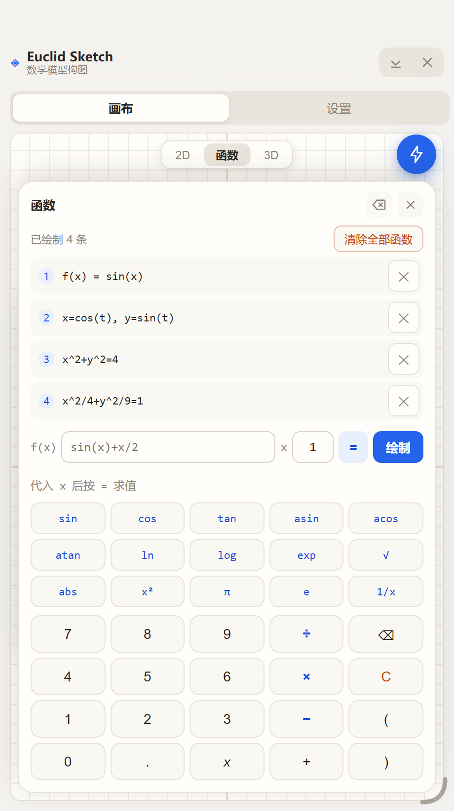
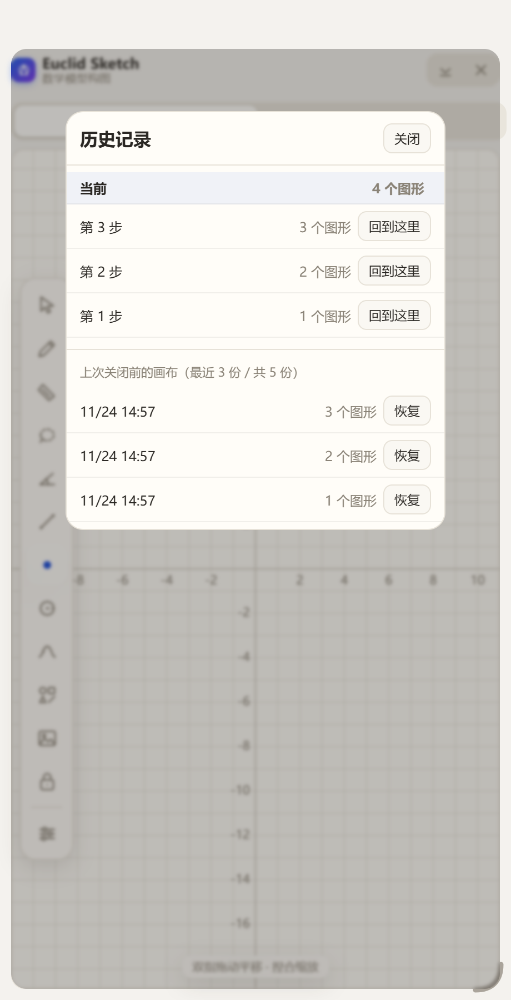
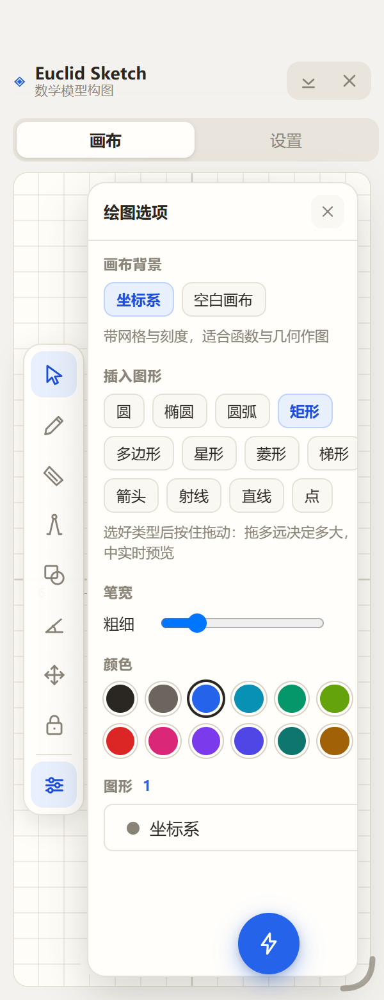

# Euclid Sketch · 数学模型构图

> 在 MarginNote 里直接画数学图：草稿纸画布、函数曲线、几何图形、立体模型，画完直接进卡片。

一个 **MarginNote 5 场景插件**。它不是把图做好再贴进笔记，而是把笔记里那块「草稿纸」变成可计算、可编辑的画布——随手画、随手改、随手写进卡片。

<p>
  
  
  
</p>

> 测试版 **0.3.0-beta.1**（2026-11-24）：交互集中修复（拖动、误触、画完消失）+ **画布自动保存**、**历史记录**、参数化作图、钢笔式曲线、迷你条可配置。
> 稳定版 **0.2.1**（2026-11-21）：目标卡自动跟随焦点卡、曲线工具可拖手柄调曲率、圆弧自由绘制。
> 下载与更新日志见 [Releases](../../releases) 与 [CHANGELOG.md](CHANGELOG.md)。



---

## 为什么做这个

在 MarginNote 里做数学题，通常是「在别处画好 → 截图 → 插进卡片」。中间断一次，改个参数就得重来。

这个插件把这一步接上：面板本身是一块画布，题目图、笔迹、公式、立体模型都在这块画布上生成，**画完一键复制进卡片批注**，图和题就在一起。

## 功能

### 画布

- **草稿纸手感**：用笔直接写、直接涂，笔迹实时呈现，可选平滑
- **14 色调色板**：墨黑、灰在前（批注常用），蓝 / 青 / 绿 / 橙 / 红 / 紫 等按批注习惯排列
- **画布铺满面板**：拉多大画多大，缩放时保持比例、图形不跳
- **两种背景**：坐标系（网格 + 刻度）或空白画布
- **双指平移 + 捏合缩放**：单指作图，双指导航，互不干扰；可开关「手指画图」防止误画
- **撤销 / 重做**：最多 50 步，连续微调自动合并

### 作图

- **任意角度**：点三下画出角度并标注度数，接近 90° 自动画方角标记
- **12 种图形**：圆 / 椭圆 / 圆弧 / 矩形 / 正多边形 / 星形 / 菱形 / 梯形 / 箭头 / 射线 / 直线 / 点，拖出来画，画完可拖控制点改
- **圆规工具**：吸附已有点、锁定半径画等圆
- **套索框选**：框住多个图形后可复制 / 剪切 / 粘贴 / 删除，也支持整组拖动
- **选中即改**：拖动控制点微调、一键切换虚线 / 实线、快捷改色

### 函数

内置科学计算器式输入面板：

- **15 个函数键**：sin / cos / tan / asin / acos / atan / ln / log / exp / √ / abs / x² / π / e / 1⁄x
- **20 键数字键盘**：数字、四则、括号、乘方、变量 x，退格与清空
- **代入求值**：`x = 2` 直接算出 `f(2)`，与绘图共用同一套求值器
- 支持函数 `f(x)`、参数方程、圆 / 椭圆方程
- **算式模式**：小窗里直接算四则与函数值（如 `2+3×4`）
- 曲线列表可逐条删，或一键「清除全部函数」



### 立体模型

10 种：圆锥 / 圆柱 / 球 / 棱锥 / 圆环 / 正方体 / 长方体 / 圆台 / 棱台 / 半球。

- **透明 / 实体**两种画法：实体模式下被挡住的棱自动画虚线（教材画法）
- 中性配色（纸白面 + 深色棱），不跟随调色板
- 单指旋转、双指缩放、参数滑块实时调


### 图片与卡片

- **插入卡片图**：把当前题目卡渲染成图放进画布，在图上直接作辅助线
- **从文件导入图片**：相册 / 文件 App 任意图片，自动压缩存储
- **图片锁定**：导入即锁定，橡皮擦不掉（左上角徽标可解锁）
- **等比缩放**：拖控制点始终按真实宽高比缩放，长图不变形；旧数据可一键「校正比例」
- **复制草图图片**：整张草图复制到剪贴板，直接粘贴进卡片批注
- **写入卡片**：把草图结构化清单写进卡片的批注（函数曲线带可复现公式），同一张卡只保留一条、原地更新

### 目标卡：对哪张卡写入 / 导入

四重保障，不用手动找卡：

1. **摘录自动跟随**：在 MN 里摘录新题产生新卡，自动成为作图目标
2. **当前页推断**：打开插件时自动识别当前文档页的题目卡
3. **卡片菜单命令**：脑图 / 文档里长按卡片 →「写入批注 / 导入此卡到草图 / 设为草图目标卡」
4. **顶栏同步**：卡片指示可点击，随时对齐到当前聚焦卡

### 布局与窗口

- **画布为主体**：工具栏收在左侧悬浮列，参数收在可开合的「绘图选项」抽屉
- **窗口自由缩放**：拖右下角实时改尺寸；收起后是迷你浮条，可直接画点 / 线段 / 圆 / 角度、插入卡片图、复制草图
- **界面可配置**：工具栏可停靠左 / 右 / 上 / 下，迷你条可切横向 / 竖向并自选按钮
- **深色模式**：默认跟随 MarginNote 白天 / 夜间，也可手动锁定
- **全面图标化**：顶栏、工具栏、调整按钮全部手绘 SVG 图标


### 历史与自动保存

- **画布自动保存**：内容变化 1.2 秒后写入本机，关掉插件再打开可以接着画
- **历史记录**：撤销按钮旁的时钟打开弹窗，按步列出「第 N 步 · 当时图形数」，任意一步可「回到这里」
- **关闭前快照**：图形增减 3 秒后留档、关闭面板 / 切后台时立即落盘，保留最近 5 份完整画布，可整份恢复
- **撤销粒度**：增删图形各算一步（连点几个点可以逐个退回），同一图形上的微调合并成一步
- **缓存管理**：设置 → 关于可查看画布 / 快照 / 设置各占多少，一键清除画布缓存
- **诊断日志**：版本号连点 5 次开启调试模式，可复制日志排查问题



---

## 安装

安装包在本仓库 [`release/`](release) 目录，可直接下载。

### 方式一：模板包 + 插件（推荐，功能完整）

卡片菜单里的三个作图命令由**模板**登记，只装插件时这些菜单项不会出现。

1. 下载 `Euclid Sketch-x.y.z.mntemplate`，存进 iPad「文件」App（AirDrop / iCloud 均可）
2. MarginNote → **设置 → 场景模板 → 管理场景模板 → 导入**
3. 再下载 `Euclid Sketch-x.y.z.mnaddon` → MarginNote → **设置 → 插件 → 导入**

### 方式二：只装插件

下载 `.mnaddon` → MarginNote → **设置 → 插件 → 导入**。面板全部绘图与图片功能可用；
目标卡依靠「摘录自动跟随 / 当前页推断 / 顶栏同步」，但没有卡片菜单命令。

> ⚠️ MarginNote 对**同版本**的包会跳过安装。重装前请先删除旧插件 / 旧模板，或使用更高版本号的包。

更详细的安装与使用说明见 [docs/install-and-usage.md](docs/install-and-usage.md)。

## 使用

打开任意学习集，在底部工具栏点插件胶囊唤出面板。顶部三档切换 **2D / 函数 / 3D**：

- **2D**：左侧工具列选工具画图；「绘图选项」抽屉里调参数与图形列表
- **函数**：计算器输入表达式 → 「绘制」加到画布
- **3D**：选模型 → 拖参数滑块 → 切「透明 / 实体」

典型的做题流程：

```
文档里摘录题目（自动成为目标卡）
  → 打开插件，点「插入卡片图」
  → 在题目图上画辅助线 / 套索整理 / 涂改
  → 点顶栏「复制」→ 回卡片批注长按粘贴
```



---

## 开发

```bash
pnpm install
pnpm check      # ESLint + 类型检查
pnpm build      # 构建面板
pnpm package    # 生成 .mnaddon / .mntemplate
pnpm verify     # 无头回归（需本机 Chrome）
pnpm sync       # 安装到本机 MarginNote（仅 macOS）
```

### 目录

```text
src/
  App.tsx              # 主界面：状态、卡片导航、导出
  useMnContext.ts      # MN 上下文：学习集 / 目标卡 / 卡片事件
  useResizablePanel.ts # 窗口缩放（rAF 跟手 + 原生触摸拦截）
  useImageActions.ts   # 图片缩放 / 校正动作
  PanelHeader.tsx      # 顶部：品牌、窗口控制、迷你条
  canvas/              # SVG 渲染与交互、坐标变换、图片锁定徽标
  stage/               # 舞台：工具列、选项抽屉、函数面板、顶部条、3D 舞台
  model/               # 图形模型、表达式求值、公式解析、几何运算
  settings/            # 设置模型与设置页
  solid/               # Three.js 立体模型
  export/              # PNG / JSON 导出、剪贴板复制
  bridge.ts            # MN 接口封装（批注 upsert / 卡片渲染 / 定位）
  repo.ts              # GitHub 仓库地址（发布前改这里）
scripts/
  verify.mjs           # 无头回归（21 项断言）
  forum/               # 社区发帖自动化（Playwright，复用登录态）
docs/                  # 文档与截图（索引见 docs/README.md）
template/              # 场景模板配置（卡片菜单命令在此登记）
```

### 发布

仓库：<https://github.com/Cobalt-Chen7777777/Euclid-Sketch>。地址写在 `src/repo.ts` 的 `GITHUB_OWNER` / `GITHUB_REPO`，插件内「GitHub 仓库」「检查更新」「更新日志」都从那里读。

发版：递增 `mnaddon.json` 的 `version` → 跑 `pnpm check && pnpm package` → 提交 `release/` 里的新包 → 打 tag。`.github/workflows/release.yml` 会在 tag 上跑 check / build / package 并挂 Release。

> 插件内「设置 → 窗口与关于 → 检查更新」读 `api.github.com/repos/Cobalt-Chen7777777/Euclid-Sketch/releases/latest`。

### 几个实现上的取舍

- **窗口缩放**：拖动中 rAF 每帧调 `mn.size`（跟手），同时冻结画布视口重算（SVG 自行拉伸）、暂停 autoFit、原生 touch 拦截宿主手势——三者缺一都会卡或乱动。
- **手势拦截**：画布、缩放把手、计算器浮条都必须在 DOM 节点上挂**非 passive** 的 `touchstart/touchmove` 做 `preventDefault`——React 的合成事件拦不住 WKWebView 宿主手势。
- **卡片目标**：官方 `/context` 的 `focusedNote` 实测恒为 null，不能依赖；目标卡由「摘录事件 + 当前文档页摘录反查 + 卡片菜单命令 + 手动同步」四路确定。
- **批注写入**：先查已有批注，以「【Euclid Sketch 草图」前缀识别上次写入并原地更新（`expectedPrefix` 防并发），空画布不写入。
- **图片比例**：`ImageShape.aspect` 记录真实宽高比，所有缩放按它校正；SVG 用 `preserveAspectRatio="none"`，盒子比例正确即不变形。
- **主题**：不写 `<html data-theme>`（脚手架禁止入口和组件操作 DOM），入口读 `mn.theme` / `prefers-color-scheme`，逐层传参 + CSS 变量。
- **求值器**：自研轻量递归下降解析器替代 mathjs（后者打包 ~650KB）。

## 已知限制

1. **图片不能程序化写回 MN**：MN 场景插件未开放图片写入与建子卡接口。当前最优路径是「复制草图图片 → 卡片批注粘贴」，或导出 PNG 手动插子卡。
2. **卡片菜单命令依赖模板**：只装 `.mnaddon` 时菜单项不出现（面板功能不受影响）。
3. **外置浮窗未启用**：native 混合形态无法在开发环境真机验证，代码留档在 [docs/archive/native-hybrid](docs/archive/native-hybrid/)。
4. **三角函数固定用弧度**（暂未提供 DEG/RAD 切换）。

## 更新日志

见 [CHANGELOG.md](CHANGELOG.md)。

## 许可

[MIT](LICENSE) © MathSketch

## 致谢

- 设置页版式参考了 CardLink 插件的设置界面（分组卡片 + 图标行 + 胶囊子导航）
- 立体图的透明 / 虚线画法参考立体几何教材与 GeoGebra 的惯例
- 社区验证与反馈来自 MarginNote 中文社区的用户
