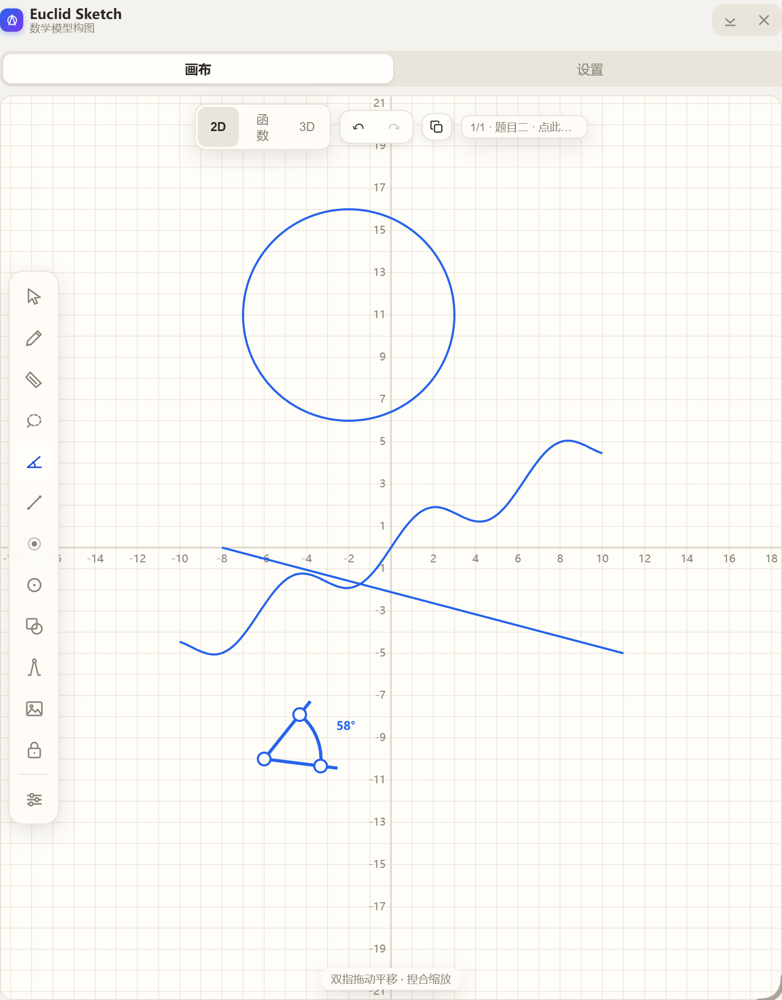
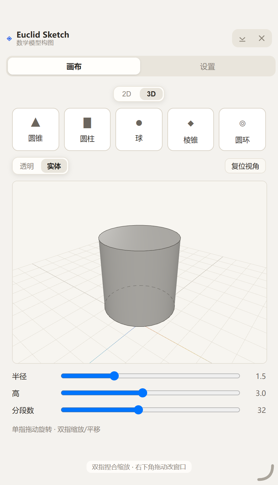
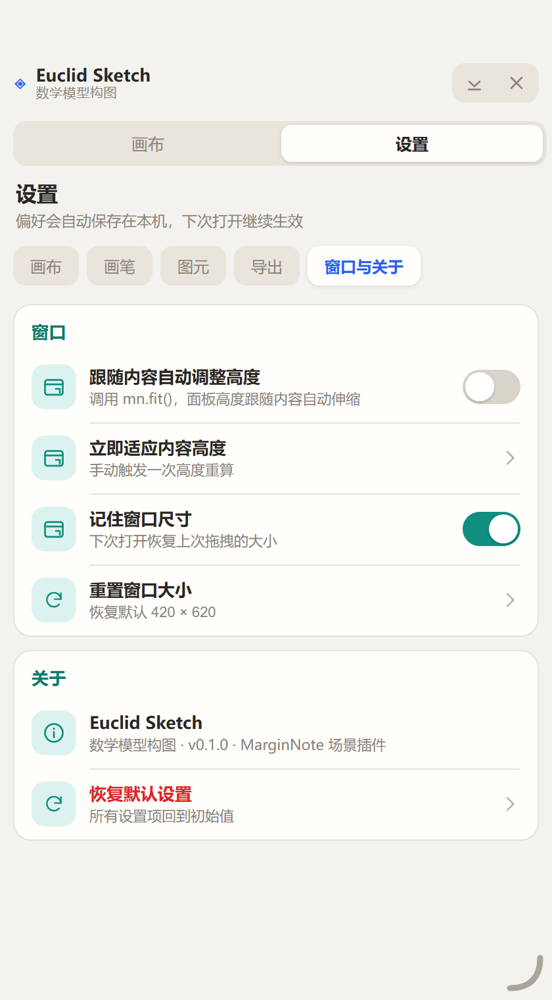

# Euclid Sketch · 数学模型构图

> 在 MarginNote 里直接画数学图：草稿纸画布、任意角度、函数曲线、立体模型，全部落在一张图上。

一个 **MarginNote 5 场景插件**。它不是把图做好再贴进笔记，而是把笔记里那块「草稿纸」变成可计算、可编辑的画布——随手画、随手改、随手导出。

<p>
  
  
  
</p>



---

## 为什么做这个

在 MarginNote 里做数学笔记，通常是「在别处画好 → 截图 → 插进卡片」。中间断一次，改一个数字就得重来。

这个插件把这一步接上：面板本身是一块画布，图、笔迹、公式、立体模型都在这块画布上生成，随时改、随时导出。

## 功能

### 画布

- **草稿纸手感**：用笔直接写、直接涂，笔迹实时呈现，可选笔迹平滑
- **14 色调色板**：墨黑、灰在前（批注常用），后接蓝/青/绿/草绿/橙/红/玫红/紫/靛/深青/金褐/暖灰，固定两行七列
- **画布铺满面板**：面板拉多大画布就多大；缩放时保持比例，图形不会跳
- **两种背景**：坐标系（网格 + 刻度）或空白画布
- **缩放平移**：双指捏合 / 滚轮缩放，平移工具拖动画布

### 作图

- **任意角度**：点顶点 → 点第一条边 → 点第二条边，度数按点击位置算，标在圆弧上；正好 90° 自动画成方角标记
- **插入图形**：圆 / 椭圆 / 圆弧 / 矩形 / 正多边形 / 星形 / 菱形 / 梯形 / 箭头 / 射线 / 直线 / 点，全部拖出来，画完还能拖控制点改
- **圆规**：点圆心 → 拖半径，可吸附已有点，支持锁定半径连续画等圆
- **选择与微调**：拖控制点改图，橡皮点选或划过擦除

### 函数

内置科学计算器式输入面板：

- **15 个函数键**：sin / cos / tan / asin / acos / atan / ln / log / exp / √ / abs / x² / π / e / 1⁄x
- **20 键数字键盘**：数字、四则、括号、乘方、变量 x，退格与清空
- **代入求值**：`x = 2` → `f(2) = 4.909297`，与绘图共用同一套求值器
- 支持圆方程、椭圆方程（含平移）、函数 `f(x)`、参数方程 `x=cos(t), y=sin(t)`
- **可清除**：曲线列表支持逐条删除，或点「清除全部函数」一键清空（不会误删手画的图元）


### 立体模型

10 种：圆锥 / 圆柱 / 球 / 棱锥 / 圆环 / 正方体 / 长方体 / 圆台 / 棱台 / 半球。

- **透明**（默认）：面半透明，能看到底面与背面结构
- **实体**：面不透明，被挡住的棱自动画成虚线（教材画法）
- 中性配色（纸白面 + 深色棱），不跟随调色板取色
- 三轴 + 地面网格，单指旋转、双指缩放，支持视角复位



### 布局与交互

- **画布为主体**：工具栏收进左侧悬浮列，参数收进可开合的「绘图选项」抽屉
- **快捷浮球**：右下角圆球展开主要功能（画笔 / 橡皮 / 画角度 / 插入图形 / 函数 / 上一张 / 下一张 / 设置）
- **卡片导航**：直接在面板里切上一张/下一张卡片（调用 `POST /notes/{id}/focus`）
- **窗口自由缩放**：拖右下角改宽高，单击把手恢复默认尺寸；可收起成迷你浮条
- **深色模式**：默认跟随 MarginNote 的白天/夜间，也可手动锁定



---

## 安装

### 方式一：模板包（推荐）

1. 从 Releases 下载 `Euclid Sketch-x.y.z.mntemplate`
2. 存进 iPad「文件」App（AirDrop / iCloud 均可）
3. MarginNote → **设置 → 场景模板 → 管理场景模板 → 导入**

### 方式二：只装插件

下载 `.mnaddon` → MarginNote → **设置 → 插件 → 导入**。

> ⚠️ MarginNote 对**同版本**的包会跳过安装。重装前请先删掉旧插件/旧模板，或使用更高版本号的包。

## 使用

打开任意学习集，在文档底部工具栏点插件胶囊即可唤出面板。顶部三档切换 **2D / 函数 / 3D**：

- **2D**：左侧工具列选工具，右下角浮球或工具列底部的滑杆图标打开绘图选项
- **函数**：底部计算器输入表达式，点「绘制」加到画布
- **3D**：选模型，拖参数滑块，切「透明/实体」


---

## 开发

```bash
pnpm install
pnpm check      # ESLint + 类型检查
pnpm build      # 构建面板
pnpm package    # 生成 .mnaddon / .mntemplate
pnpm sync       # 安装到本机 MarginNote（仅 macOS）
```

### 发布

改好 `src/repo.ts` 里的 `GITHUB_OWNER`，然后打 tag 即可——`.github/workflows/release.yml` 会跑 check/build/package，并把 `.mnaddon` 与 `.mntemplate` 挂到 Release：

```bash
git tag v0.1.0 && git push origin v0.1.0
```

> 插件内「设置 → 窗口与关于 → 检查更新」读的就是这个 Release，所以仓库至少要有一个 Release 才会返回版本号。

### 目录

```text
src/
  App.tsx              # 主界面：状态、卡片导航、导出
  PanelHeader.tsx      # 顶部：品牌、窗口控制、迷你条
  canvas/              # SVG 渲染与交互、坐标变换
  stage/               # 舞台组件：工具列、选项抽屉、函数面板、快捷浮球、3D 舞台
  model/               # 图形模型、表达式求值、公式解析、几何与角度运算
  settings/            # 设置模型、设置页、自动高度
  solid/               # Three.js 立体模型
  export/              # PNG / JSON 导出
  repo.ts              # GitHub 仓库地址（发布前改这里）
  update.ts            # 更新检查
```

### 几个实现上的取舍

- **窗口缩放**用 `mn.size(宽, 高)` + 70ms 节流，位移按 `screenX/screenY` 算。用 `clientX/clientY` 会因面板边拖边变尺寸而自激抖动。
- **画布手势**必须在 svg 上挂**非 passive** 的 `touchstart` 监听做 `preventDefault`——React 的 `onTouchStart` 是 passive 的，拦不住宿主的原生拖窗手势。
- **画布尺寸变化**去抖 120ms 再重算，且保持 px/单位不变：否则拖窗口时整个画面会被逐帧重新缩放，看起来像闪烁。
- **主题**不写 `<html data-theme>`（脚手架禁止入口和组件操作 DOM），改为入口读 `mn.theme` / `prefers-color-scheme`，逐层传到组件，用 class + CSS 变量实现。
- **求值器**自研轻量递归下降解析器替代 mathjs（后者单是打包就 ~650KB）。

## 已知限制

1. **图片不能直接写回笔记**：MN 场景插件未开放图片写入接口，采用「导出 PNG + 批注说明」的降级方案。
2. **浮窗需要 native 层**：本版包含 `native/main.js`（混合插件），用 `showFloatingInMode` 把面板以迷你浮条形态显示在 MN 画布上。
3. **三角函数固定用弧度**（尚未提供 DEG/RAD 切换）。

## 更新日志

见 [CHANGELOG.md](CHANGELOG.md)。

## 许可

[MIT](LICENSE) © MathSketch

## 致谢

- 设置页的版式参考了 CardLink 插件的设置界面（分组卡片 + 图标行 + 胶囊子导航）
- 立体图的透明/虚线画法参考了立体几何教材与 GeoGebra 的惯例
